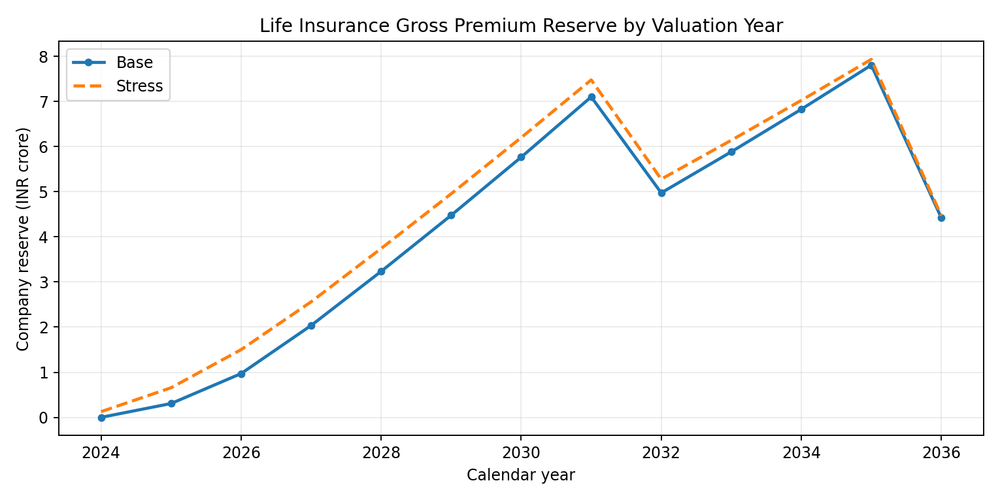

# Life Insurance Gross Premium Reserving

A Python model for calculating gross premiums and policy reserves for annual-premium, without-profits endowment assurance contracts. The program reads a portfolio and valuation assumptions from Excel, projects reserves by policy year, and exports an Excel report and a reserve trend chart.

## Features

- Gross premium calculation using the equivalence principle
- Prospective and retrospective reserve calculations
- Reconciliation of the two methods on a consistent basis
- Portfolio reserve aggregation by calendar year
- Sensitivity analysis for interest rates and mortality
- Input checks and automated unit tests

## Project structure

```text
.
├── input/
│   └── life_insurance_input.xlsx
├── output/
│   ├── gross_premium_reserves_output.xlsx
│   └── year_wise_reserves.png
├── tests/
│   └── test_reserves.py
├── main.py
├── requirements.txt
└── README.md
```

## Setup

Python 3.10 or newer is recommended.

```bash
python -m pip install -r requirements.txt
python main.py
python -m unittest discover -s tests -v
```

Custom input and output paths:

```bash
python main.py --input input/life_insurance_input.xlsx --output-dir output
```

## Input data

The input workbook contains four sheets:

| Sheet | Description |
| --- | --- |
| `Assumptions` | Interest rates, initial and renewal expenses, stress parameters |
| `Portfolio` | Issue year, age, term, sum assured, and issued policy count |
| `Mortality` | One-year death probabilities (`qx`) by age |
| `Guide` | Workbook field descriptions |

Each portfolio row represents a cohort of identical contracts. The included workbook has three example cohorts.

## Valuation methodology

The contract pays the sum assured at the end of the year of death during the term, or at maturity if the policyholder survives. Premiums are annual and payable in advance. Initial and renewal expenses are allowed for separately.

Define:

- `S`: sum assured
- `G`: annual gross premium
- `I`: fixed initial expense
- `alpha`: initial expense proportional to premium
- `e`: fixed annual renewal expense
- `beta`: renewal expense proportional to premium
- `a`: temporary life annuity-due factor
- `A`: endowment assurance factor

The gross premium is derived from:

```text
G × a = S × A + I + alpha × G + (e + beta × G) × (a - 1)

G = [S × A + I + e × (a - 1)] / [a - alpha - beta × (a - 1)]
```

**Prospective reserve** at an anniversary is the expected present value (EPV) of future benefits and expenses less the EPV of future gross premiums.

For `1 <= t < n`, with remaining term `n - t`:

```text
V_pro(t) = S × A(x+t, n-t) + (e + beta × G - G) × a(x+t, n-t)
```

At duration zero, the calculation also includes initial expenses. The premium is set so that `V_pro(0) = 0` on the pricing basis.

**Retrospective reserve** is calculated recursively from premiums, expenses, interest and expected death claims:

```text
V_retro(0) = 0

V_retro(t+1) = [(V_retro(t) + G - expense(t)) × (1+i) - q(x+t) × S]
               / [1 - q(x+t)]
```

Here, `expense(0) = I + alpha × G`; later, `expense(t) = e + beta × G`.

Reserves are valued just before advance premiums and expenses due at each policy anniversary, after any preceding year-end benefits have been paid. No reserve is held after maturity.

Under a consistent pricing and valuation basis, the prospective and retrospective results reconcile. The stress case uses lower interest and higher mortality for prospective valuation, with gross premiums held fixed.

## Portfolio reserve and output

Expected surviving policies are obtained by applying survival probabilities to the initial cohort size. The portfolio reserve in each calendar year is the sum of expected in-force policies multiplied by the applicable per-policy reserve.

The output workbook contains:

| Sheet | Contents |
| --- | --- |
| `Guide` | Valuation basis and conventions |
| `Premium_Calculation` | Gross premiums and actuarial factors |
| `Policy_Year_Reserves` | Base, retrospective, and stressed reserves by cohort/year |
| `Yearly_Company_Reserves` | Aggregated base and stress reserve amounts |
| `Validation_Checks` | Prospective/retrospective differences |

With the included assumptions, the model produces a peak base portfolio reserve of approximately **INR 7.81 crore in 2035**. This is a reserve at a single valuation date, not a sum of reserves across years.



## Assumptions and limitations

The example portfolio and mortality probabilities are **synthetic** and are not AM92 rates or insurer data. The model is a deterministic CM1 illustration, not a statutory, IFRS 17, or solvency-capital valuation. It excludes lapses, surrenders, reinsurance, taxes and investment uncertainty.

**Reference:** CM1, Chapter 21, *Gross premium reserves* (prospective and retrospective valuation, reserve equality, and recursion).
